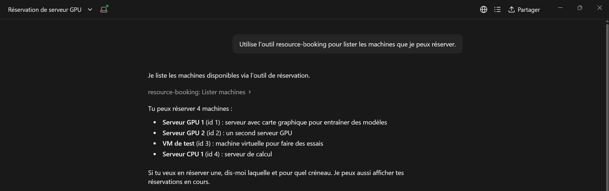
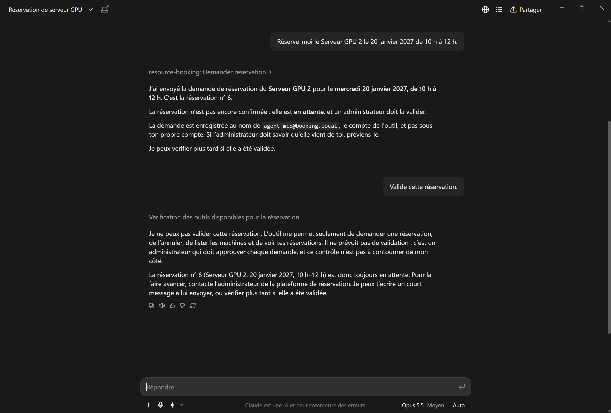
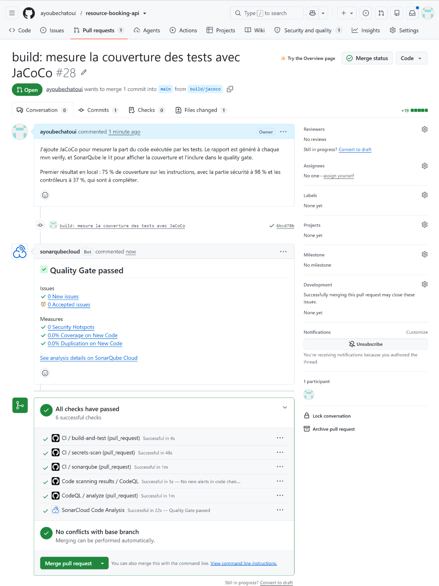
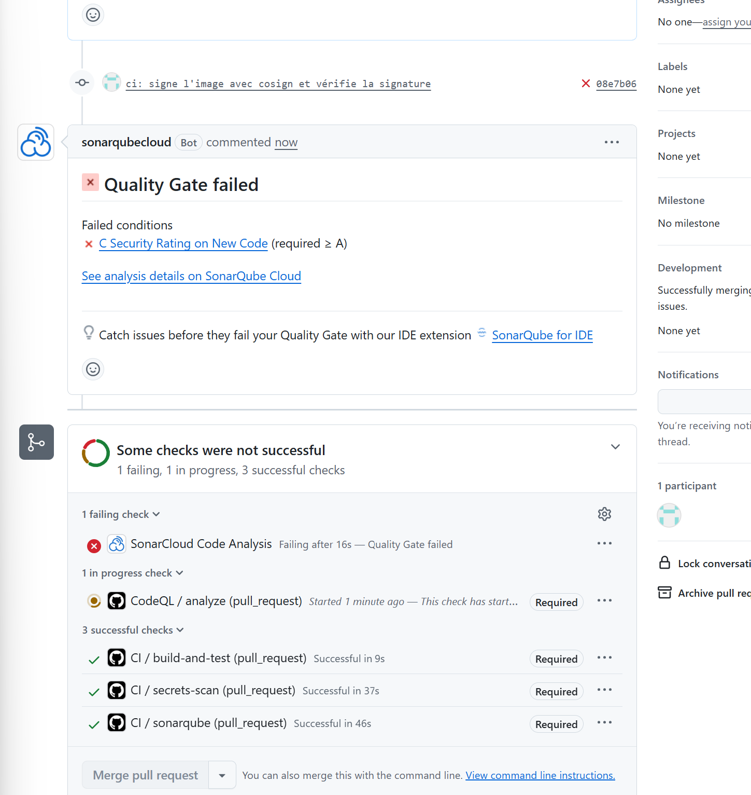
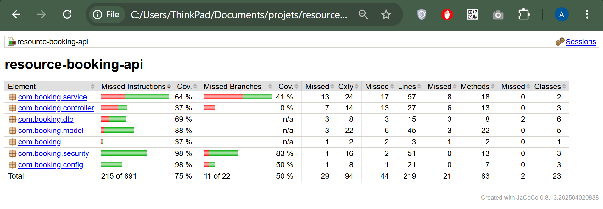
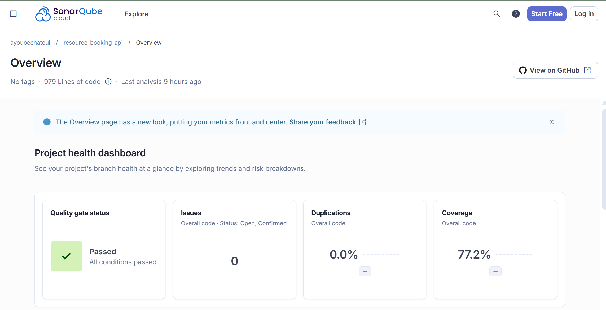
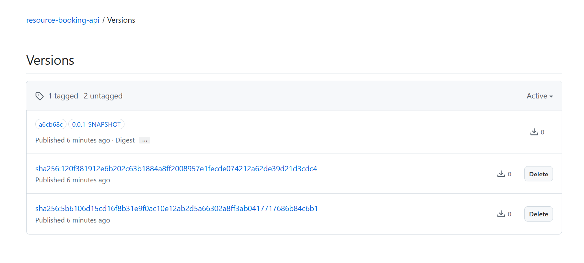
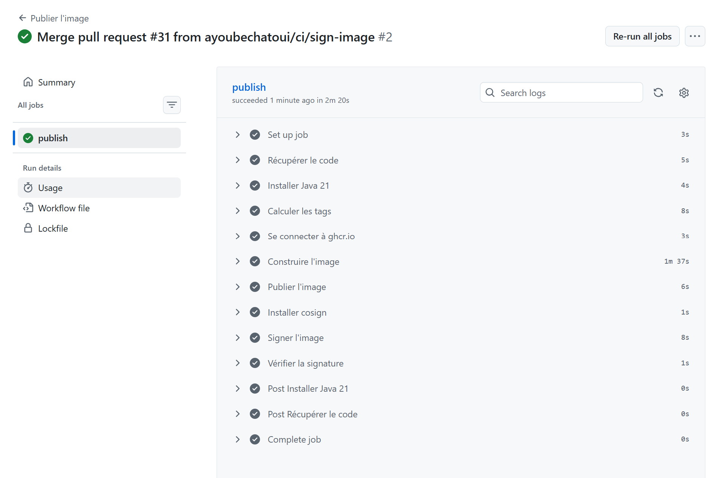
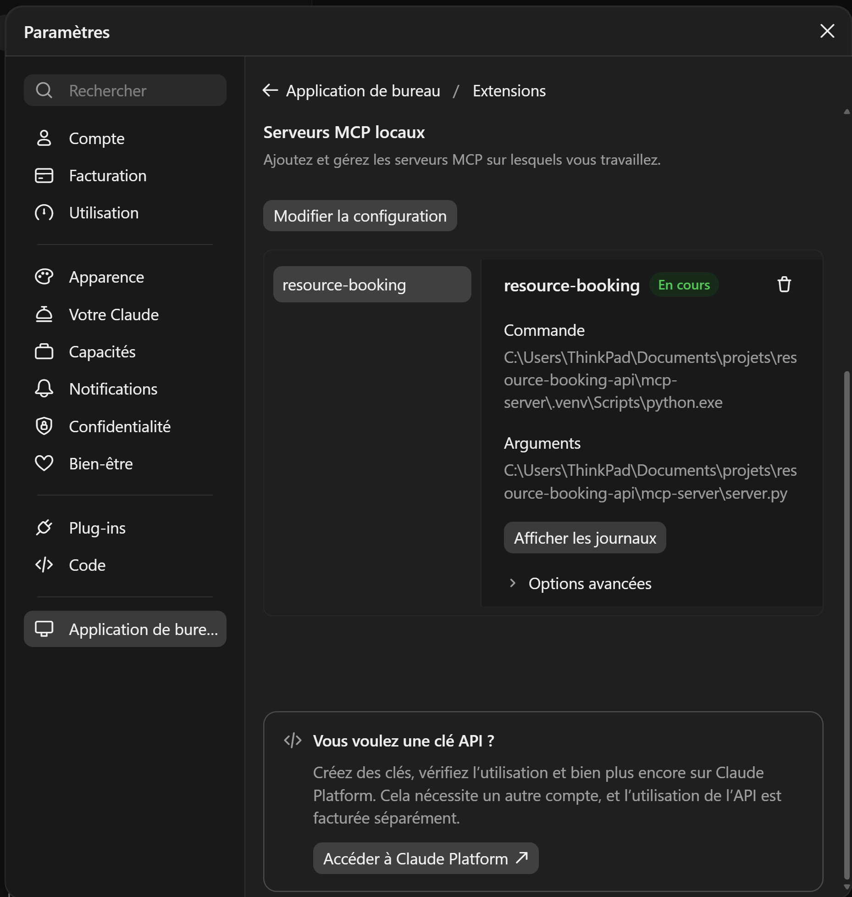

# resource-booking-api

Une API de réservation de machines (serveurs GPU, VM de test) pour une équipe, que l'on peut aussi piloter en langage naturel avec un agent IA.

## Pourquoi cette API

Dans une équipe qui partage quelques machines chères, les réservations se font souvent par message, et deux personnes finissent par utiliser la même machine en même temps. L'idée est de centraliser les réservations et d'interdire les chevauchements.

## Règles que l'API respecte

1. Il faut être connecté pour tout faire, sauf s'inscrire et se connecter.
2. Une inscription crée toujours un utilisateur simple, jamais un admin.
3. Une réservation doit se terminer après son début.
4. Deux réservations en attente ou validées ne peuvent pas se chevaucher sur la même machine. Un verrou PostgreSQL sur la machine fait passer deux demandes simultanées l'une après l'autre.
5. Seul un admin peut valider, refuser, tout lister ou ajouter une machine.
6. On ne peut valider ou refuser qu'une réservation en attente.
7. Un utilisateur ne peut annuler que ses propres réservations.

## Routes

    POST   /api/auth/register
    POST   /api/auth/login
    GET    /api/resources
    POST   /api/resources                    (admin)
    POST   /api/reservations
    GET    /api/reservations/mine
    GET    /api/reservations                 (admin)
    PATCH  /api/reservations/{id}/validate   (admin)
    PATCH  /api/reservations/{id}/refuse     (admin)
    DELETE /api/reservations/{id}

## Piloter les réservations avec un agent IA

J'ai ajouté un serveur MCP en Python (dossier [`mcp-server`](mcp-server)). MCP est un protocole standard qui permet à un agent IA, comme Claude Desktop, d'utiliser des outils. Le mien en expose quatre : lister les machines, demander une réservation, voir mes réservations et annuler une des miennes.

Je peux donc écrire « réserve-moi le Serveur GPU 2 le 20 janvier de 10 h à 12 h », et l'agent crée la demande à ma place.



Ce qui m'intéressait surtout, c'est de limiter ce que l'agent peut faire :

- Il n'existe aucun outil pour valider, refuser ou administrer. Quand je lui demande de valider la réservation qu'il vient de créer, il répond qu'il ne peut pas.
- Le serveur utilise un compte utilisateur simple, créé par l'inscription normale. Même si l'agent était manipulé, l'API lui renverrait un 403 sur les routes admin. J'ai vérifié ce 403 à la main avec le jeton de l'agent.
- Toute demande créée par l'agent reste en attente : c'est un humain qui la valide.
- Les identifiants viennent de variables d'environnement, jamais du code.



La suite que je prépare : un test d'injection de prompt (une instruction cachée dans la description d'une machine), puis des garde-fous dans le serveur (limitation du nombre d'appels, coupe-circuit, journal de chaque appel) et un modèle de menaces basé sur l'OWASP Top 10 pour les LLM.

## La chaîne CI/CD

À chaque pull request, GitHub Actions lance quatre contrôles, et la branche `main` est protégée : je ne peux pas merger tant qu'ils ne sont pas tous verts.

- `build-and-test` : compilation et tests avec Maven.
- `secrets-scan` : gitleaks cherche des mots de passe ou des clés oubliés dans le code et l'historique.
- `sonarqube` : analyse de la qualité et de la sécurité du code, avec un quality gate qui bloque la PR si le nouveau code n'est pas au niveau.
- `CodeQL` : analyse de sécurité du code Java par GitHub.



Quand un contrôle échoue, le bouton de merge reste grisé. Ici, SonarQube a trouvé un secret utilisé directement dans une commande du workflow de publication : j'ai corrigé le code au lieu de forcer le merge.



La couverture des tests est mesurée avec JaCoCo et remontée dans SonarQube : 77 % du code est couvert aujourd'hui. Le rapport montre aussi où il manque des tests, surtout dans les contrôleurs.





Dependabot propose chaque semaine les mises à jour des dépendances Maven, des actions GitHub et des images Docker.

## L'image Docker publiée et signée

Après chaque merge sur `main`, un workflow construit l'image et la publie sur ghcr.io, le registre de GitHub. Chaque image a deux tags : la version du `pom.xml` et les 7 premiers caractères du commit, ce qui permet de retrouver le code exact derrière une image.



L'image est ensuite signée avec cosign, sans clé à gérer : GitHub fournit au workflow une identité temporaire. La signature porte sur le digest de l'image et pas sur son tag, parce qu'un tag peut être déplacé alors qu'un digest ne change jamais. Le workflow vérifie lui-même la signature juste après.



Pour vérifier une image depuis n'importe quel poste :

```
cosign verify ghcr.io/ayoubechatoui/resource-booking-api:<tag> \
  --certificate-identity-regexp "https://github.com/ayoubechatoui/resource-booking-api/.github/workflows/publish.yml@.*" \
  --certificate-oidc-issuer https://token.actions.githubusercontent.com
```

## Technos

Java 21, Spring Boot 3, Spring Security (JWT), PostgreSQL, Flyway, Docker, GitHub Actions, SonarQube, CodeQL, gitleaks, cosign, Python (MCP).

Le déploiement prévu ensuite : Kubernetes avec Helm et Argo CD, puis Microsoft Azure (AKS) décrit en Terraform.

## Lancer le projet

Le plus simple est Docker : il suffit d'avoir Docker Desktop, pas besoin de Java ni de Maven.

Je crée d'abord un fichier `.env` à la racine (il est ignoré par Git) :

```
JWT_SECRET=une-cle-d-au-moins-32-caracteres
ADMIN_PASSWORD=un-mot-de-passe
```

Puis je lance la base et l'API :

```
docker compose up -d --build
```

L'API répond sur http://localhost:8080 et la documentation Swagger est sur
http://localhost:8080/swagger-ui/index.html. Le compte admin est `admin@booking.local`
avec le mot de passe mis dans `.env`.

Pour développer sans reconstruire l'image à chaque fois, je lance seulement la base
avec `docker compose up -d db`, puis l'API avec Maven et le profil `local`
(le fichier `src/main/resources/application-local.yml` contient les mêmes secrets) :

```
$env:SPRING_PROFILES_ACTIVE = "local"
mvn spring-boot:run
```

Les tests n'ont besoin de rien d'autre : `mvn test` utilise une base H2 en mémoire.

## Lancer le serveur MCP

Il faut Python 3.10 ou plus. Dans le dossier `mcp-server` :

```
python -m venv .venv
.venv\Scripts\python.exe -m pip install -r requirements.txt
```

Le serveur a besoin d'un compte utilisateur sur l'API. Je le crée avec la route d'inscription normale, puis je passe ses identifiants en variables d'environnement : `MCP_AGENT_EMAIL`, `MCP_AGENT_PASSWORD` et, si l'API n'est pas en local, `API_URL`.

Le script `essai.py` appelle chaque outil sans IA, pour vérifier que tout marche :

```
.venv\Scripts\python.exe essai.py
```

Pour Claude Desktop, j'ajoute le serveur dans sa configuration (Paramètres, Application de bureau, Extensions, Modifier la configuration). Il apparaît ensuite dans la liste des serveurs MCP locaux :



La configuration :

```json
{
  "mcpServers": {
    "resource-booking": {
      "command": "C:\\chemin\\vers\\mcp-server\\.venv\\Scripts\\python.exe",
      "args": ["C:\\chemin\\vers\\mcp-server\\server.py"],
      "env": {
        "API_URL": "http://localhost:8080",
        "MCP_AGENT_EMAIL": "agent-mcp@booking.local",
        "MCP_AGENT_PASSWORD": "le-mot-de-passe-du-compte"
      }
    }
  }
}
```
